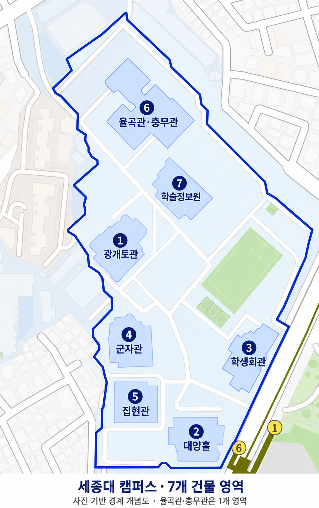

# 세종대 경계와 7개 건물 영역 개념도

2026-10-10 사용자가 제공한 네이버 지도와 부동산 사이트 경계 사진을 참고해 만든 이미지입니다.

## 반영한 내용

- 첫 번째 지도의 방향과 도로 배치를 바탕으로 두 번째 사진의 경계를 시각적으로 맞췄습니다.
- labgemini4의 광개토관, 대양홀, 학생회관, 군자관, 집현관, 율곡관/충무관, 학술정보원 영역만 표현했습니다.
- 율곡관·충무관은 코드의 한 행에 대응하는 하나의 모델 영역입니다.
- 다른 교내 건물은 제거하고 도로·운동장은 위치 파악용 배경으로 남겼습니다.

## 사용 범위

내장 이미지 생성 도구로 편집한 **사진 기반 개념도**입니다. 경계와 건물 윤곽은 근사 표현이며 측량·지적 경계 또는 정확한 좌표 데이터가 아닙니다. 건물 명칭 참고: [세종대학교 공식 캠퍼스맵](https://www.sejong.ac.kr/kor/intro/campus-map.do?type=BUILDING).

labgemini4 원본과 계산 결과는 변경하지 않았습니다. 현재 코드는 x −150~150 m, y 0~550 m의 사각 격자를 평가합니다. 이 개념도의 둘레 안만 평가하려면 원점·축척·회전을 검증한 경계 좌표와 사용자 마스크를 별도로 적용하고 세 조건 결과를 다시 계산해야 합니다.

원본 사진은 [참고 이미지 폴더](../originals)에 보존했습니다. 편집 프롬프트는 [prompt.txt](prompt.txt)에 기록했습니다.
