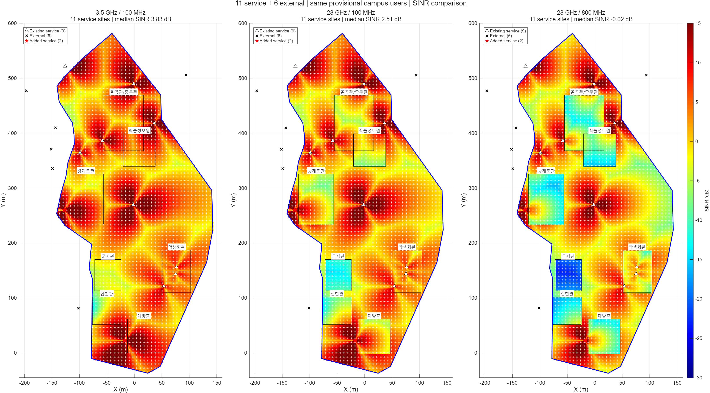
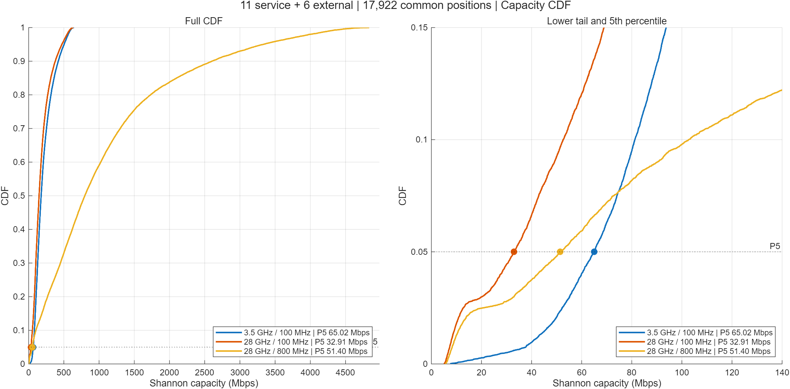
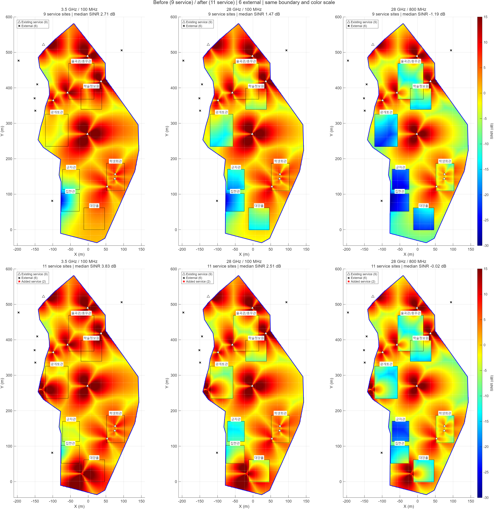

# 기지국 추가 후 세 조건 히트맵·CDF와 1·2단계 비교

2026-10-10 · 실제 MATLAB R2025a 계산 · 서비스 사이트 **11개** / 외부 간섭 사이트 **6개**

## 공통 조건

- 기존 서비스 9개 + 추가 (-127.5,260), (-17.5,22.5) m. 외부 간섭 6개 유지.
- 7개 건물 영역, 2.5 m 격자, 같은 잠정 캠퍼스 경계 안 **17,922개 위치**. 실내 4,601개, 실외 13,321개.
- 높이 BS 25 m / UT 1.5 m, 사이트당 3섹터, 섹터 총전력 43 dBm, NF 7 dB, 부하율 0.5.
- labgemini4의 결정론적 NLOS 경로손실 식·상대각 안테나 패턴·low-loss 외벽 손실을 유지했다. 확률 LOS/NLOS·shadow fading·20회 시행을 추가하지 않았다.
- 가장 강한 서비스 섹터를 재선택하고 나머지 서비스 섹터와 외부 섹터를 간섭으로 합산한다. 외부 기지국은 경계 밖이어도 계산에서 제외하지 않는다.
- 전송률은 위치별 단일 스트림 Shannon 용량이며 실제 다운로드 속도나 셀 전체 동시 처리량이 아니다.
- 경계는 사진·건물 좌표 기반 **잠정 경계**다. 서비스/외부 구분은 입력 모델의 역할이며 11곳의 실제 교내 위치·설치 가능성·높이를 조사해 확정했다는 뜻이 아니다.

## 추가 후 전체 결과

| 조건 | SINR 중앙값 dB | SINR 5백분위 dB | 용량 중앙값 Mbps | 용량 5백분위 Mbps | 용량 평균 Mbps |
|---|---:|---:|---:|---:|---:|
| 3.5 GHz / 100 MHz | 3.83 | -2.45 | 177.29 | **65.02** | 214.95 |
| 28 GHz / 100 MHz | 2.51 | -5.91 | 147.68 | **32.91** | 182.86 |
| 28 GHz / 800 MHz | -0.02 | -13.42 | 797.61 | **51.40** | 1,093.65 |

5백분위는 정렬된 17,922개 전송률 중 **ceil(0.05×17,922)=897번째 값**이다. 하위 5% 평균과 다르다. 전체·실내·실외 및 동일 경계의 추가 전 9개 사이트 결과는 [summary.csv](summary.csv)에 있다.



색상은 실제 SINR dB 값에 대응하며 세 조건과 추가 전후 모두 **-30~15 dB**로 동일하다. 취약 실내 값을 구분하기 위한 이번 그림 범위이며, 과거 사각 영역 그림의 -15~25 dB와는 다르다. 붉은 별이 추가 두 사이트다.



CDF는 같은 사용자 위치를 동일 가중치로 집계한 경험분포다. 점선 CDF=0.05에서의 전송률을 색별 점과 범례에 표시했다. 전체 CDF는 1까지 도달하며 확대 그림은 CDF 0~0.15 구간이다.

## 1단계 — 같은 100 MHz에서 주파수 비교

**3.5 GHz / 100 MHz vs 28 GHz / 100 MHz**, 동일한 서비스 11개·외부 6개·평가 위치·전력·안테나·부하율을 사용한다.

- 전체 SINR 중앙값은 **3.83→2.51 dB**, 약 **1.32 dB 감소**했다.
- 용량 중앙값은 **177.29→147.68 Mbps**, 약 16.7% 감소했다.
- 전체 용량 5백분위는 **65.02→32.91 Mbps**, 약 **49.4% 감소**했다.
- 특히 실내 5백분위는 **52.04→8.55 Mbps**로 차이가 크다. 28 GHz 히트맵에서 남은 실내 취약 영역을 볼 수 있다.

이 코드의 경로손실 주파수 항은 20log10(fc)이므로 3.5→28 GHz의 해당 손실 항은 약 18.06 dB 증가한다. 외벽 손실도 약 12.70→17.83 dB로 커진다. 다만 신호와 간섭 링크가 함께 약해지므로 SINR 감소가 그 손실량과 같지는 않다. 잡음은 두 조건 모두 -87 dBm이며, 낮아진 수신전력에 비해 잡음 영향이 커지는 위치에서 SINR이 더 낮아진다.

발표 문장: **같은 100 MHz와 동일 배치에서 28 GHz는 중앙값뿐 아니라 하위 5% 성능이 더 낮았고, 특히 실내에서 주파수에 따른 수신전력·외벽 손실과 잡음 영향이 크게 나타났다.**

## 2단계 — 대표 주파수·대역폭 조건 비교

**3.5 GHz / 100 MHz vs 28 GHz / 800 MHz**를 비교한다. 이는 주파수와 대역폭을 함께 바꾼 대표 운용 조건 비교이며 대역폭만의 효과라고 해석하지 않는다.

- 전체 용량 중앙값은 **177.29→797.61 Mbps**, 약 **4.50배**다.
- 전체 용량 5백분위는 **65.02→51.40 Mbps**, 약 **20.9% 낮다**.
- 전체 CDF의 중간 구간에서는 28 GHz/800 MHz가 높은 전송률을 보이지만, 하위 5%에서는 3.5 GHz/100 MHz가 더 높다. 확대 CDF에서 곡선이 교차하므로 한 조건이 모든 사용자에게 유리하다고 표현하지 않는다.

| 사용자 구분 | 3.5 GHz/100 MHz 중앙값 / 5백분위 Mbps | 28 GHz/800 MHz 중앙값 / 5백분위 Mbps |
|---|---:|---:|
| 전체 | 177.29 / 65.02 | 797.61 / 51.40 |
| 실내 | 178.13 / 52.04 | 151.87 / 10.04 |
| 실외 | 176.93 / 72.83 | 1,068.69 / 285.89 |

실외의 높은 전송률이 전체 중앙값 상승에 크게 기여하지만 실내 저성능 구간은 여전히 남아 있다. 이번 결과에서는 실내 중앙값도 3.5 GHz/100 MHz보다 낮다.

발표 문장: **28 GHz의 넓은 대역폭은 전체·실외 전송률을 높였지만 실내 취약 사용자 성능까지 보장하지는 않았다. 중앙값과 5백분위를 함께 봐야 한다.**

## 대역폭 효과만 분리: 28 GHz/100 MHz vs 28 GHz/800 MHz

- 주파수·사이트·송신 총전력·간섭 링크는 같고 대역폭만 8배로 변경했다.
- 총 잡음은 **-87→-77.97 dBm**, 약 **9.03 dB 증가**한다.
- SINR 중앙값은 **2.51→-0.02 dB**로 낮아졌다.
- 용량 중앙값은 **147.68→797.61 Mbps**, 약 **5.40배** 높아졌다.
- 용량 5백분위는 **32.91→51.40 Mbps**, 약 **56.2% 증가**했다. 모든 위치에서 800 MHz 용량이 100 MHz보다 낮지 않은지도 검증했다.

대역폭은 8배지만 용량은 8배가 아니다. 잡음 증가가 SINR을 낮추기 때문이다. 잡음에 지배되고 SINR이 매우 작은 위치에서는 C≈B·SINR/ln2, SINR≈S/(B·n0)여서 C≈S/(n0·ln2)로 대역폭 효과가 제한된다. 이 설명은 총 송신전력을 고정한 현재 모델 조건에 해당한다.

## 같은 경계에서 추가 전후 비교

이번 추가 전 결과는 **같은 17,922개 위치**에서 서비스 9개·외부 6개로 다시 계산했다. 과거 사각 격자 26,741개 위치 결과를 그대로 비교하면 평가 영역 변경 효과와 기지국 추가 효과가 섞인다.

| 조건 | 9개 사이트 5백분위 Mbps | 11개 사이트 5백분위 Mbps | 개선율 |
|---|---:|---:|---:|
| 3.5 GHz / 100 MHz | 40.83 | 65.02 | +59.3% |
| 28 GHz / 100 MHz | 7.54 | 32.91 | +336.5% |
| 28 GHz / 800 MHz | 8.82 | 51.40 | +482.8% |



세 조건 모두 5백분위와 중앙값이 개선됐지만 모든 위치의 개선은 아니다. 소폭을 포함한 악화 위치 비율은 각각 **80.63%, 79.71%, 79.20%**다. 추가 사이트가 다른 위치에는 간섭원이 되기 때문이다. 28 GHz/800 MHz의 악화 크기는 [직전 배치 분석](../../04_site_selection/02_candidate_evaluation/degradation_analysis.json)에 있으며 전체 위치의 5.08%가 10% 넘게 감소했다.

## 재현과 검증

MATLAB에서 저장소 루트를 기준으로 실행:

```matlab
addpath('02_code/matlab');
run_added_sites_three_cases;
```

- [실행 함수](../../02_code/matlab/run_added_sites_three_cases.m). 원본 labgemini4는 보존했다.
- 비교 수치·CDF 좌표·악화율·추가 검증은 [후처리 함수](../../02_code/analysis/summarize_added_sites_three_cases.py)를 실행해 재생성한다.
- 동일 사용자·같은 경계, 중복 좌표 없음, 유한 SINR·용량, 동일 대역폭 주파수 순서, 28 GHz 대역폭별 SINR/용량 순서 검증.
- 추가 전 3.5 GHz는 원본 결과와 겹치는 위치에서 대조하고, 추가 전 28 GHz는 잠정 경계 결과와 대조했다.
- 추가 후 28 GHz/800 MHz는 직전 배치 선정 결과와 대조했다. 최대 오차는 [run_metadata.json](run_metadata.json)에 기록했다.
- [전체·실내·실외 요약](summary.csv), [추가 전후 변화](placement_changes.csv), [1·2단계 비교 수치](step1_step2_comparisons.csv), [위치별 세 조건](positions_three_cases.csv), [서비스 11개 좌표](service_sites.csv), [외부 6개 좌표](external_sites.csv), [MATLAB 원시 결과](three_cases_results.mat).
- [CDF 좌표](cdf_values.csv), [조건·실내외별 악화 크기](degradation_by_case.csv), [검증 기록](verification.json).

개별 그림:

| 조건 | SINR 히트맵 | 전송률 CDF·5백분위 |
|---|---|---|
| 3.5 GHz/100 MHz | [PNG](sinr_3p5GHz_100MHz.png) | [PNG](cdf_3p5GHz_100MHz.png) |
| 28 GHz/100 MHz | [PNG](sinr_28GHz_100MHz.png) | [PNG](cdf_28GHz_100MHz.png) |
| 28 GHz/800 MHz | [PNG](sinr_28GHz_800MHz.png) | [PNG](cdf_28GHz_800MHz.png) |

정밀 경계·현장 설치 가능성·실제 높이·최종 모델이 바뀌면 결과를 다시 계산해야 한다. 이번 계산은 28 GHz 기준으로 고른 두 위치를 세 조건에 동일하게 적용한 평가이며, 3.5 GHz에서 별도 최적 배치를 탐색한 결과는 아니다.
