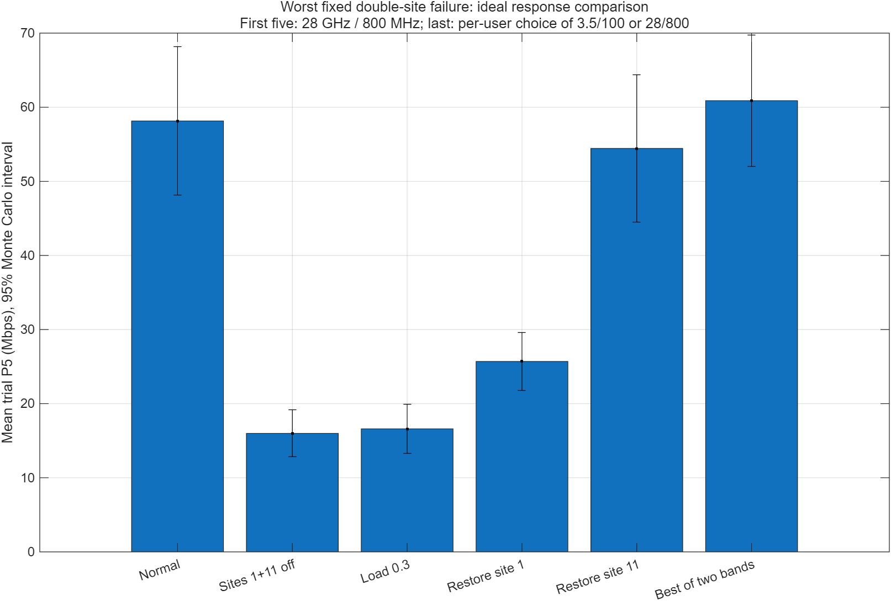

# 세종대 캠퍼스 통신 시뮬레이션 포트폴리오

**3.5 GHz·28 GHz 채널 비교, 취약 사용자 분석, 기지국 두 곳 선정, 독립 난수 20회와 장애 복원력 검증을 연결한 조별 프로젝트입니다.**

MATLAB · Python · 3GPP TR 38.901 참고 · GitHub 자료 관리

실험 데이터 기준 **2026-10-10**, 포트폴리오 구조 정리 **2026-10-12**. 현재 공개 범위는 기존 **비공개 저장소**입니다.

## 처음 보는 사람을 위한 읽는 순서

| 목적 | 바로 열기 |
|---|---|
| 프로젝트가 무엇을 해결했는지 | [포트폴리오 사례 설명](01_portfolio/CASE_STUDY.md) |
| 두 기지국 위치를 어떻게 골랐는지 | [위치 선정 과정](04_site_selection/PLACEMENT_PROCESS.md) |
| 발표자가 자세히 이해하고 싶다면 | [34쪽 상세 해설 PDF](07_presentation/01_presenter_guide/세종대_통신프로젝트_발표자_상세해설서.pdf) · [읽기본](07_presentation/01_presenter_guide/발표자_상세해설서.md) |
| 최신 그림과 수치를 확인하려면 | [서비스 11개 세 조건](05_comparison_results/03_added11_campus/) |
| 20회 검증과 장애 대응을 확인하려면 | [확률·장애·대응](06_resilience/20_trials_and_failures/) |
| 코드를 직접 재현하려면 | [실행 순서](02_code/REPRODUCE.md) |

## 문제와 접근

높은 주파수와 넓은 대역폭의 장단점을 동일 조건에서 분리하고, 전체 평균만으로 놓치기 쉬운 실내·저성능 사용자를 보완할 두 위치를 선정했습니다. 추가 사이트의 간섭 부작용과 장애 의존성까지 확인했습니다.

## 핵심 결과

**고정 채널**, 서비스 11개·외부 간섭 6개·잠정 경계 내부 17,922개 위치의 결과입니다. 단위 Mbps.

| 조건 | 전송률 중앙값 | 전송률 5백분위 |
|---|---:|---:|
| 3.5 GHz / 100 MHz | 177.29 | 65.02 |
| 28 GHz / 100 MHz | 147.68 | 32.91 |
| 28 GHz / 800 MHz | 797.61 | 51.40 |

- 같은 100 MHz에서 28 GHz는 P5가 낮았습니다. 800 MHz는 전체 중앙값을 높였지만 실내 취약성을 모두 해소하지는 못했습니다.
- 추가 좌표는 **(-127.5,260), (-17.5,22.5) m**입니다. 같은 경계의 28/800 P5가 **8.82→51.40 Mbps**로 높아졌습니다.
- **확률 확장**에서는 새 섀도 페이딩 환경 20개 모두 기존 9개 대비 P5가 개선됐습니다. 정상 11개 28/800의 시행별 P5 평균은 **58.15 Mbps**입니다.
- 28/800에서 최악 단일 장애는 추가 11번, 이중 장애는 1+11번 중단입니다. P5 평균은 각각 **25.69 / 15.98 Mbps**이며, 이중 장애 때 11번을 먼저 복구하면 **54.43 Mbps**였습니다.

고정 채널 P5와 확률 모델의 **시행별 P5 평균**은 다른 지표입니다. 근거 CSV·설정·검증을 각 결과 폴더에 보관했습니다.

## 주제별 폴더

| 폴더 | 포함 자료 |
|---|---|
| [01_portfolio](01_portfolio/) | 사례 설명, 전체 목록, 해시·이동 이력·구조 검증 |
| [02_code](02_code/) | 현재 MATLAB·Python, 코드 설명과 재현 절차 |
| [03_campus_data](03_campus_data/) | 지도 원본·개념도·조사 입력 |
| [04_site_selection](04_site_selection/) | 경계·취약점·후보·평가함수·조합·선정 좌표 |
| [05_comparison_results](05_comparison_results/) | 주파수·대역폭·추가 전후 히트맵·CDF·CSV·MAT |
| [06_resilience](06_resilience/) | 독립 20회·기지국 장애·스트레스·대응 |
| [07_presentation](07_presentation/) | 발표자 PDF·읽기본·구성 안내, 예제 PPT |
| [08_project_management](08_project_management/) | 현재 체크리스트·역할·진행 기록·1일차 자료 |
| [09_references_archive](09_references_archive/) | 과제·표준·원본·이전 버전·예제·보고서·로그 |

작은 CSV·JSON·실행 로그·그림은 관련 단계의 폴더에 함께 묶고, 폴더별 README와 [전체 자료 목록](01_portfolio/catalog/FILE_INDEX.md)에서 찾도록 구성했습니다. [이전→현재 경로표](01_portfolio/catalog/path_migration_2026-10-12.csv)로 과거 링크를 추적할 수 있습니다.

## 검증 범위와 현재 상태

실제 MATLAB 실행과 단위·표본·통계·기존 수치 일치를 검증했습니다. 원본 및 이전 버전은 보존했습니다. 팀 프로젝트의 결과물이며 개별 팀원 기여를 임의로 확정하지 않았습니다.

경계·후보 설치·높이는 잠정입니다. 위치별 Shannon 전송률은 실제 다운로드 속도나 셀 총 처리량이 아닙니다. SF 확장은 완전한 LOS/NLOS·이동·빠른 페이딩 모델이 아니며, 장애 대응은 재접속 지연·부하 재분배를 제외한 이상적 조건을 포함합니다. 검토한 후보 중 최선으로, 전역·장애 최적 배치를 확정하지 않았습니다.

**완료:** 코드·계산·위치 선정 근거·확률/장애 검증·34쪽 해설서·자료 정리. **남음:** 정밀 경계·현장 설치 확인·최종 모델·세종대 최종 PPT·팀 리허설·제출. [체크리스트](08_project_management/current/팀작업_체크리스트.md)
