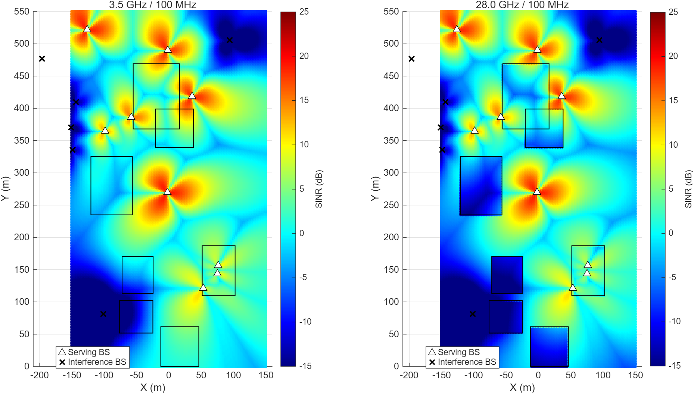
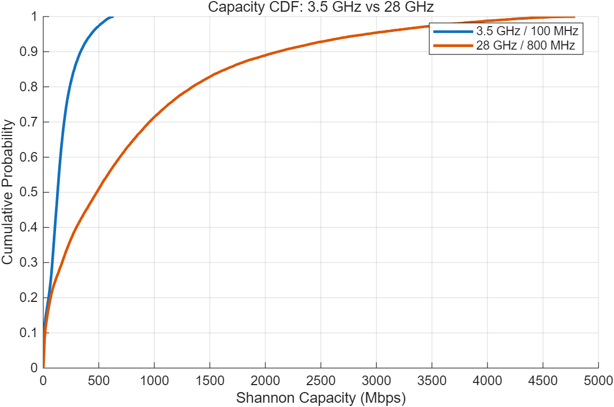

# 연구실인턴 캠퍼스 통신 시뮬레이션

세종대 캠퍼스에서 3.5 GHz와 28 GHz의 SINR 및 Shannon 전송률을 비교하고, 기지국 추가 배치를 검토하는 MATLAB 미니프로젝트 자료 모음입니다.

## 처음 볼 자료

| 목적 | 자료 |
|---|---|
| 현재 코드 실행 | [labgemini4.m](matlab/labgemini4.m) |
| 사용자 보관 수정 보고서 | [2일차 수정본](reports/day2/revisions/user/2일차_주파수_대역폭_비교_수정본.docx) |
| MATLAB 실행 결과와 그림 | [labgemini4 결과](results/labgemini4/) |
| 원본과 코드 변경 설명 | [코드 버전 안내](docs/CODE_VERSIONS.md) |
| 팀 일정과 1일차 체크리스트 | [프로젝트 문서](docs/project/) · [1일차 자료](docs/day1/) |
| 발표자료 | [예제 발표 초안](presentations/) |
| 전체 파일과 원본 확인 | [자료 목록](docs/FILE_INDEX.md) · [SHA-256 목록](data/file_manifest.csv) |

## 자료 구분

**현재 세종대 좌표 기반 코드는 `matlab/labgemini4.m`입니다.** 9개 서비스 사이트, 6개 외부 사이트, 7개 건물 영역과 26,741개 평가 위치를 사용합니다. 좌표 조사 출처와 사업자 정보의 확정 여부는 별도 조사 기록을 확인해야 합니다.

`matlab/campus_model`은 앞서 만든 별도 확률 채널·배치 탐색 시뮬레이터입니다. 그 안의 `demo_*` 결과와 `presentations`의 발표 초안은 **순천향대 예제 영역을 사용한 검증 예제이며 세종대 최종 결과가 아닙니다.** 해당 패키지의 세종대 입력 양식은 아직 `awaiting_survey` 상태입니다. 이 예제 수치를 labgemini4 결과와 섞어 사용하지 않습니다.

## 현재 코드 실행

MATLAB에서 저장소 루트를 현재 폴더로 지정하고 실행합니다.

```matlab
run(fullfile('matlab', 'labgemini4.m'));
```

MATLAB R2025a 실행 결과를 보관했습니다. 스크립트는 기존 변수를 지우고 열린 그림을 닫은 뒤 실행됩니다. 수정 전 버전은 `matlab/legacy`에 보존했습니다.

| 조건 | 평균 Mbps | 중앙값 Mbps | 5백분위 Mbps |
|---|---:|---:|---:|
| 3.5 GHz / 100 MHz | 155.61 | 129.31 | 2.69 |
| 28 GHz / 100 MHz | 134.60 | 103.51 | 2.33 |
| 28 GHz / 800 MHz | 802.89 | 481.89 | 7.32 |

간섭 부하율은 0.5, 섹터당 전력은 43 dBm, NF는 7 dB입니다. 5백분위는 정렬한 사용자 전송률의 1,338번째 값이며 하위 5% 평균과 다릅니다. 이 수치는 위치별 단일 스트림 Shannon 전송률로, 실제 다운로드 속도나 셀 총 처리량을 뜻하지 않습니다.





## 폴더 구성

```text
matlab/           현재 코드, 이전 버전, 별도 확률 채널 시뮬레이터
reports/          원본 보고서와 사용자 및 Codex 수정본
results/          labgemini4 MATLAB 실행 산출물과 이전 실행 화면
docs/             체크리스트, 검증 안내, 버전 설명, 자료 목록
data/             조사 기록과 파일별 SHA-256 목록
presentations/    예제 발표자료
references/       과제 안내, 원본 MATLAB, 참고 보고서, 3GPP 문서
archives/         기존 배포 패키지
tools/            이전 문서·발표 생성 스크립트
```

## 원시 결과 보관

GitHub 단일 파일 제한을 넘는 예제 원시 MAT 두 개는 같은 비공개 저장소의 [Releases → data-archive-2026-10-10](https://github.com/20261123/research-lab-intern/releases/tag/data-archive-2026-10-10)에 보관합니다. [원시 결과 안내](docs/LARGE_FILES.md)에 다운로드 후 복원 위치와 SHA-256을 적었습니다. 작은 MAT와 CSV 및 모든 결과 그림은 저장소에 포함합니다.

## 보고서와 자료 사용 시 참고

- 보고서는 원본, 사용자 수정본, Codex 생성본을 모두 보존했습니다. Codex 생성본은 수치·그림을 MATLAB 실행값과 대조했지만 Word 페이지 배치의 시각적 검증은 완료되지 않았습니다.
- 현재 코드는 모든 링크에 동일한 NLOS 형태의 식과 외벽 손실을 적용하는 단순화입니다. LOS 확률·shadow fading·실내 이동거리 손실·실제 스케줄링은 포함하지 않습니다.
- 과거 발표 초안과 1일차 문서는 작성 당시의 상태를 보존한 자료입니다. 현재 코드 상태는 이 README와 버전 안내를 기준으로 확인합니다.
- 참고 문서는 작성 기관·원저자의 권리가 적용됩니다. 별도 오픈소스 라이선스는 지정하지 않았습니다.
- MATLAB 개인 환경 설정, 중복 미리보기, 실패한 Word 변환 파일과 프로젝트 밖의 일반 MATLAB 수업 실습 파일은 자료에 포함하지 않았습니다.
