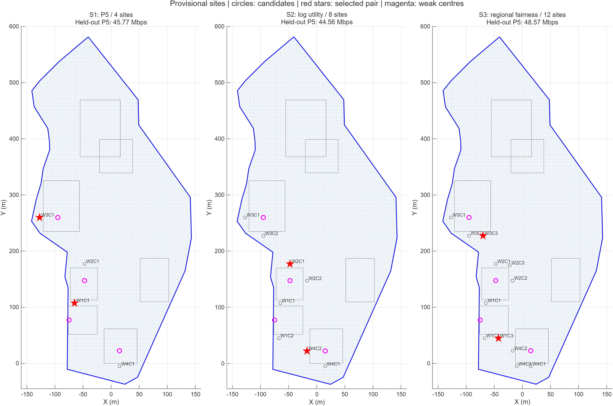
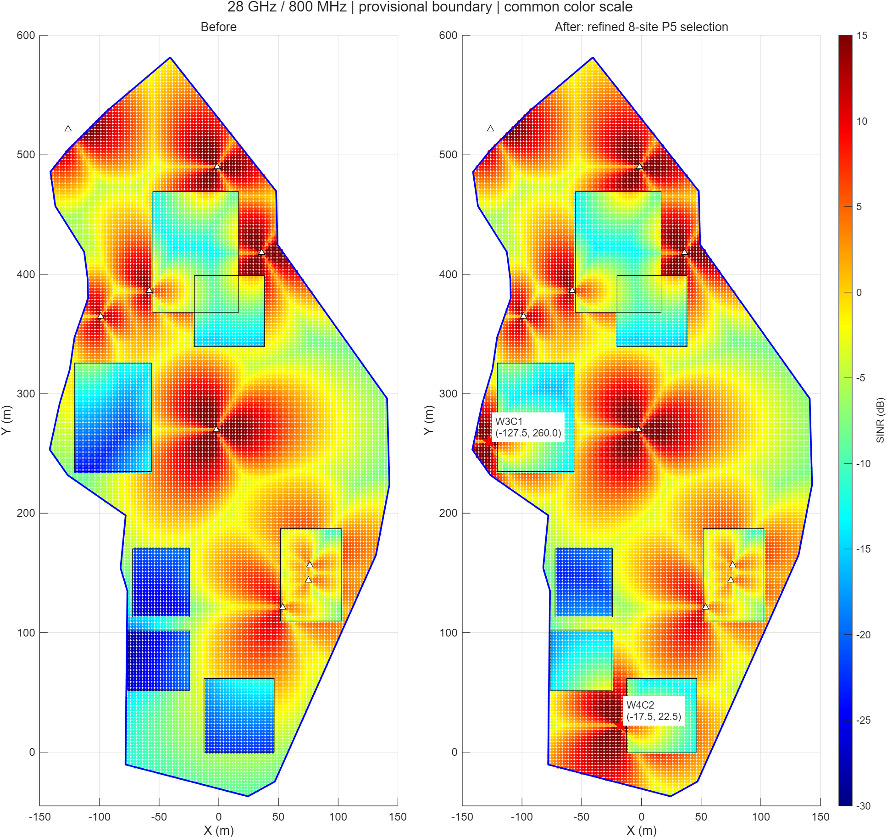
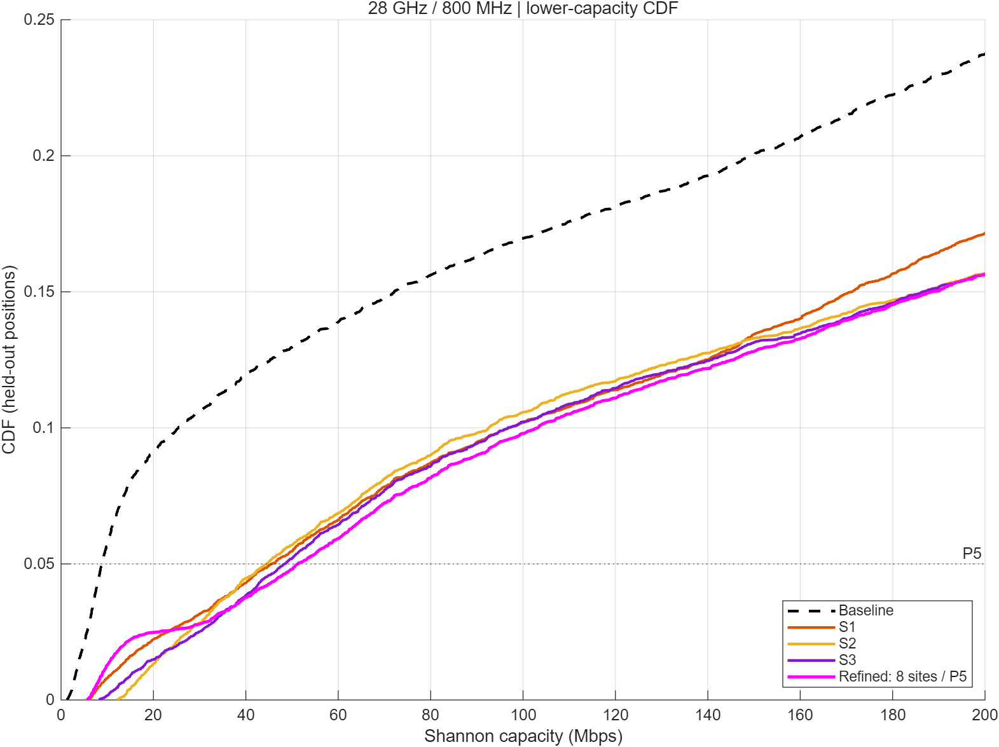

# 취약 구간 기반 추가 기지국 선정 시나리오 3개

2026-10-10 · 28 GHz / 800 MHz · labgemini4 기반 **실제 MATLAB 계산**

**최종 권장 방법은 ‘후보 8곳 + 경계 내부 전체 전송률 5백분위 최대화’다.** 검토한 후보에서 선택된 두 좌표는 **(-127.5, 260.0)**, **(-17.5, 22.5) m**다. 기존 잠정 경계와 모델에 대한 배치 결과이며 실제 설치 가능성 또는 실제 캠퍼스의 전역 최적 위치를 확정한 결과는 아니다.

## 1. 공통 조건과 후보를 만드는 이유

출발 취약 구간은 W1 집현관 (-75,77.5), W2 군자관 (-47.5,147.5), W3 광개토관 (-95,260), W4 대양홀 (15,22.5)다. 대표점은 실내 사용자 위치이므로 기지국 후보를 별도로 만들었다.

각 구간 주변에서 다음 **기하적 설치 가정**을 만족하는 2.5 m 격자를 후보로 사용했다.

- 취약 대표점에서 75 m 이내.
- 잠정 캠퍼스 경계 안쪽 10 m 이상.
- 코드의 7개 건물 사각형 밖에서 건물까지 5 m 이상.
- 기존 서비스 사이트까지 25 m 이상, 이미 선정한 후보까지 25 m 이상.
- 신규 사이트 높이 25 m, 단말 높이 1.5 m, 사이트당 3섹터, 섹터당 43 dBm, 기존 방향·소자 패턴 유지.

이 간격은 후보를 만드는 프로젝트 가정이다. 법정 이격거리·전파 커버리지·실제 설치 허가 기준이 아니다. 실지도에 남아 있는 다른 건물, 토지 이용, 전원·접근성, 25 m 구조물 가능 여부는 확인하지 못했다. 옥상 높이를 조사한 결과도 아니다.

구간별로 가장 가까운 허용 지점을 C1로 잡고, 기존 후보에서 25 m 이상 떨어진 지점 중 해당 취약점에 가장 가까운 것을 C2·C3로 잡았다. 동률은 x·y 순서로 처리했다. W1→W4 순서로 C1을 모두 선정하고, 다시 C2, C3를 선정해 네 구간에 균등하게 선택지를 제공했다. **4곳은 각 구간 1개, 8곳은 2개, 12곳은 3개**로 구성된 중첩 후보 집합이다.

| 취약 구간 | C1: 4·8·12곳 시나리오 | C2: 8·12곳 시나리오 | C3: 12곳 시나리오 |
|---|---|---|---|
| W1 집현관 | (-65.0,107.5) | (-67.5,45.0) | (-42.5,45.0) |
| W2 군자관 | (-47.5,177.5) | (-17.5,147.5) | (-22.5,175.0) |
| W3 광개토관 | (-127.5,260.0) | (-95.0,227.5) | (-70.0,227.5) |
| W4 대양홀 | (15.0,-5.0) | (-17.5,22.5) | (-10.0,-5.0) |

좌표 단위는 m, 원점·축은 사용자 코드와 동일하다. y<0인 후보는 잠정 경계의 남쪽 외삽 부분에 있다. 좌표 맞춤·경계 오차 때문에 특히 이런 후보는 실제 지도 확인이 필요하다. 후보 목록과 경계·건물·기존 사이트까지의 거리는 [candidates.csv](candidates.csv)에 공개했다.

## 2. 세 가지 평가함수

두 추가 사이트의 조합을 p, 추가 전/후 위치별 전송률을 C0·Cp라 한다. 탐색 표본에만 아래 평가함수를 적용한다. Q0.05는 nearest-rank 5백분위다. 모든 기존 사이트는 유지하고 추가 두 사이트도 서빙 후보 및 간섭원으로 포함한다. 가장 강한 섹터를 다시 선택하고 나머지 섹터 전력을 합산한다.

### S1 — 적은 후보로 저성능 사용자 우선

- 후보 4곳(C1만), 두 곳 선택 **6조합**.
- **F1(p) = Q0.05(Cp)** 최대화.
- 전체 캠퍼스에서 성능이 낮은 사용자의 경계값을 직접 높인다.
- 선택: W1C1 **(-65,107.5)** + W3C1 **(-127.5,260)**.
- 장점: 과제의 하위 성능 개선과 직접 연결되고 설명이 간단하다.
- 한계: 구간별 위치 선택지가 하나뿐이다. 전체 5백분위가 높아도 특정 구간은 개선되지 않을 수 있다.

### S2 — 위치 대안을 늘려 전체 사용자 균형 고려

- 후보 8곳(C1·C2), 두 곳 선택 **28조합**.
- **F2(p) = (1/N) Σ ln(Cp(i)/C0(i))** 최대화.
- 사용자별 상대 개선·악화를 함께 반영한다. 로그는 이미 빠른 일부 사용자만 크게 개선하는 효과를 완화하며, 전송률의 기하평균 개선 비율을 최대화하는 것과 같다. 지역별 개선을 보장하지는 않는다.
- 선택: W2C1 **(-47.5,177.5)** + W4C2 **(-17.5,22.5)**.
- 장점: 낮은 전송률과 전체 분포를 함께 고려한다. 이번 비교에서 중앙값이 가장 높았다.
- 한계: 전체 5백분위 자체를 최대로 만드는 함수는 아니다.

### S3 — 네 취약 구간 중 가장 덜 개선된 구간 우선

- 후보 12곳(C1·C2·C3), 두 곳 선택 **66조합**.
- 취약 구간 Rk는 기존 대표점 반경 25 m 안의 경계 내부 표본으로 고정한다.
- **F3(p) = min(k=1..4) [Q0.05(Cp | Rk) / Q0.05(C0 | Rk)]** 최대화.
- 네 구간의 개선 비율 중 가장 작은 값을 키운다. 가장 약한 구간의 절대 전송률만 높이는 함수와 다르다.
- 선택: W1C3 **(-42.5,45)** + W3C3 **(-70,227.5)**.
- 장점: 어떤 취약 구간도 상대적 개선에서 소외되지 않도록 한다.
- 한계: 전체 캠퍼스 5백분위 또는 전체 중앙값의 최대화와는 목표가 다르다.

## 3. 같은 기준으로 비교하는 과정

자기 평가함수 점수끼리 비교할 수는 없다. Mbps, 로그 평균, 개선 배율은 단위와 뜻이 다르다. 따라서 모든 선택 결과를 다음 공통 절차로 평가했다.

1. 경계 내부 17,922개 격자를 바둑판 홀짝으로 **탐색 8,960개 / 비교 8,962개**로 나눴다. 같은 위치를 골라 최적화하고 그 위치로만 평가하는 것을 피하기 위한 분리다. 이웃 표본이 공간적으로 가깝고 모델이 결정론적이므로 독립 채널 검증이나 통계적 일반화 보장은 아니다.
2. 각 후보 조합을 실제 MATLAB으로 계산하고 **탐색 표본**에서 각 목적함수의 최선 조합을 선택했다. 목적함수 동률이면 탐색 5백분위, 중앙값 순으로 비교했다.
3. 선택한 결과를 같은 **비교 표본 전체 5백분위**로 순위화했다. 동률이면 네 구간 중 최소 개선 비율, 중앙값, 악화 사용자 비율 순으로 판단했다. 이는 이번 프로젝트의 저성능 사용자 개선 목표에 맞춘 공통 규칙이다.
4. 최종 설명용으로 전체 17,922개 위치의 통계도 별도로 계산했다. 아래 표는 **전체 표본** 결과이며 실제 선택에 사용한 비교 표본 결과와 구분한다.

| 방법 | 전체 5백분위 Mbps | 전체 중앙값 Mbps | 네 구간 최소 5백분위 개선 배율 |
|---|---:|---:|---:|
| 추가 전 | 8.82 | 652.11 | 1.00 |
| S1: 4곳 + F1 | 45.41 | 723.68 | 1.00 |
| S2: 8곳 + F2 | 44.27 | 845.61 | 2.26 |
| S3: 12곳 + F3 | 48.25 | 768.36 | 2.57 |
| 교차 비교 권장: **8곳 + F1** | **51.40** | **797.61** | **1.70** |

초기 3개 중에는 S3가 공통 비교 표본의 5백분위도 가장 높았다(48.57 Mbps). S2는 중앙값이 가장 높고 S3는 네 구간의 최소 개선 배율이 가장 높다. 무엇을 ‘잘 고른다’고 부르는지 먼저 정해야 한다.

## 4. 후보 수와 함수 효과를 구분하기 위한 교차 비교

초기 3개는 후보 수와 함수가 동시에 바뀐다. S3가 좋은 이유를 ‘후보가 많아서’ 또는 ‘공정성 함수가 좋아서’라고 단정할 수 없다. 따라서 **4·8·12곳 × F1·F2·F3**의 9개 조건을 비교했다. 중첩 후보이므로 고유 링크 조합은 66개를 계산하고 재사용했다. 6+28+66=100은 세 후보 집합의 명목 조합 수이며 서로 중복된다.

아래는 동일 비교 표본에서의 전체 5백분위다.

| 후보 수 | F1: 전체 5백분위 | F2: 로그 평균 | F3: 구간별 공정성 |
|---|---:|---:|---:|
| 4곳 | 45.77 | 32.06 | 32.06 |
| 8곳 | **51.32** | 44.56 | 32.06 |
| 12곳 | **51.32** | 44.56 | 48.57 |

F1은 후보를 4→8곳으로 늘리면 좋아졌고, 8→12곳에서는 같은 조합을 골랐다. F2도 8곳 이후 선택이 같았다. F3는 12곳에서 추가 위치 대안의 효과가 나타났다.

따라서 **전체 5백분위 개선을 주목적으로 하면 8곳+F1을 권장한다.** 12곳+F1과 동일한 두 위치·동일한 성능을 얻으면서 검토 후보와 조합이 적다. ‘후보는 많을수록 좋다’ 또는 ‘세 함수 중 하나가 모든 목적에서 우월하다’는 결론이 아니다.

## 5. 최종 권장 조합과 해석

- W3C1: **(-127.5,260.0) m**, 코드상 광개토관 서쪽 건물 외부 후보.
- W4C2: **(-17.5,22.5) m**, 코드상 대양홀 서쪽 건물 외부 후보.
- 두 위치의 평면 간격은 약 261.74 m로 근접 설치 중복을 피한다.
- 비교 표본 5백분위 **8.78→51.32 Mbps**.
- 전체 표본 5백분위 **8.82→51.40 Mbps**, 약 **482.8% 증가**(약 5.83배).
- 전체 중앙값 **652.11→797.61 Mbps**.

전체 표본의 구간별 5백분위는 W1 1.51→20.21, W2 3.64→6.19, W3 6.02→138.76, W4 7.19→138.91 Mbps다. 가장 약한 W1에 사이트를 직접 놓지 않아도 다른 위치의 새 사이트가 W1·W2에 신호를 제공할 수 있다. 간섭과 서빙 재선택까지 반영한 조합 결과로 평가해야 한다.

## 6. 악화 구간과 민감도 확인

기지국 추가로 모든 위치가 좋아지지는 않았다. 권장 조합에서 전체 위치의 **79.20%**는 조금이라도 전송률이 떨어졌다. 악화된 위치의 상대 감소율 중앙값은 **0.68%**이며, 전체 위치 중 10% 넘게 감소한 비율은 **5.08%**, 20% 넘게 감소한 비율은 **1.38%**다. 새 사이트가 서빙으로 선택되지 않는 위치에서는 추가 간섭이 생긴다. 높은 개선율과 함께 이 결과도 발표해야 한다. 이 감소율을 수용할지 여부는 팀의 성능 목표에 달려 있다.

부하율 0.5·1.0, 경계 기본·30 m 축소·30 m 확대의 6조건에서 선택 위치는 고정한 채 다시 평가했다. 확대/축소는 사용자 평가 범위만 바꾸며 실제 설치 가능 경계를 확인한 것이 아니다. 축소 경계에서는 W1 반경 25 m 표본이 없어 구간별 지표가 제외될 수 있으므로 민감도 비교는 전체 5백분위로 한다.

| 방법 | 6조건 중 최소 전체 5백분위 개선율 |
|---|---:|
| S1 | +194.0% |
| S2 | +264.4% |
| S3 | +299.2% |
| 권장 8곳+F1 | **+343.7%** |

권장안은 시험한 조건에서 개선이 유지됐고 위 최소 개선율도 가장 높았다. 다만 경계를 확대하면 S1의 절대 5백분위가 더 높은 경우가 있어 **모든 조건에서 같은 조합이 1위인 것은 아니다.** 최종 순위는 정밀 경계가 확정되면 다시 계산해야 한다. 광개토관 후보는 추정 경계까지 12.38 m라 경계 적합 오차보다 가까우며 특히 위치 확인이 필요하다.

## 7. 검증과 재현 자료

- MATLAB R2025a 실행. 신규 링크 함수로 기존 서비스·외부 링크를 재계산해 기존 캐시와 대조했다. 신호 상대 오차 최대 약 1.0e-14, 간섭 약 3.1e-14로 일치했다.
- 원본 labgemini4는 수정하지 않았다. 현재 모델은 확률 채널 없는 결정론적 NLOS 식, low-loss 외벽 손실 형태다. 20회 독립 확률 검증을 수행했다고 표현하지 않는다.
- Shannon 전송률은 실제 다운로드 속도나 모든 사용자의 동시 셀 처리량이 아니다.
- 이 3개 함수와 후보 수는 팀 프로젝트를 위해 만든 비교 시나리오이며 학교 자료나 3GPP가 지정한 의무 조건이 아니다.
- [후보 생성](../../../analysis/prepare_three_scenarios.py) → [MATLAB 비교 실행](../../../matlab/evaluate_three_placement_scenarios.m).
- [후보 좌표](candidates.csv), [3개 시나리오 결과](scenario_comparison.csv), [9조건 교차 비교](factorial_3x3.csv), [66개 조합](all_66_pairs.csv), [민감도](sensitivity.csv), [최종 위치별 결과](selected_positions.csv), [악화 분석](degradation_analysis.json), [실행·조건·추천 요약](run_summary.json).

원본 경계와 기존 결과는 [잠정 취약점 분석](../weak_regions_provisional/)을 참조한다. 다음 팀 작업은 실제 경계·후보 접근성·높이·토지 사용을 확인하고, 최종 좌표를 확정한 뒤 두 주파수의 추가 전후 비교를 완성하는 것이다.
