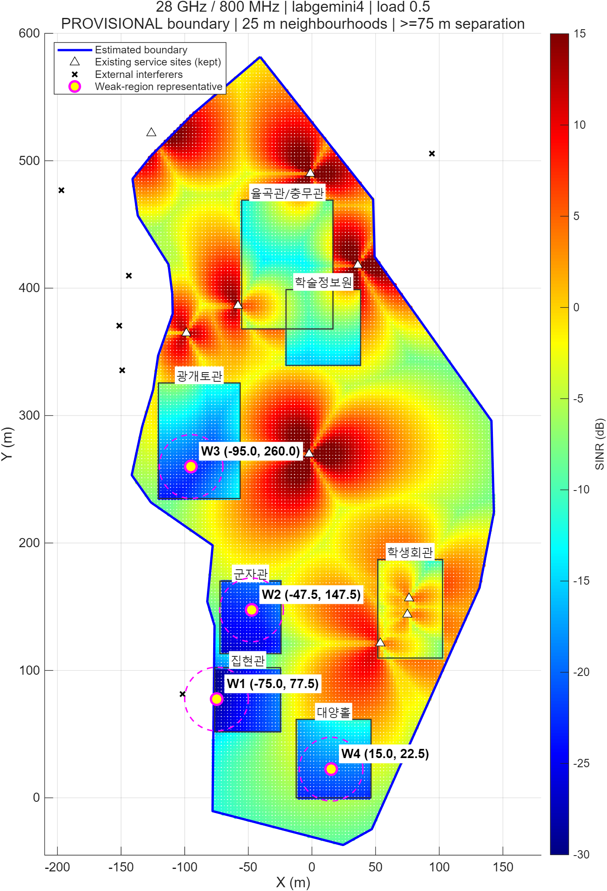
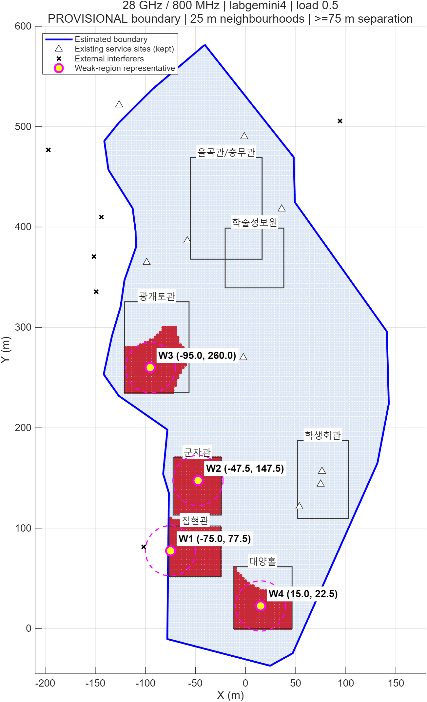

# 28 GHz·800 MHz 잠정 캠퍼스 취약 구간 분석

분석일: 2026-10-10. 사용자가 **건물 좌표로 경계를 근사한 잠정 분석**을 선택했다. 기준 모델은 labgemini4, 섹터당 43 dBm, NF 7 dB, 부하율 0.5, 2.5 m 격자다.

## 결론: 대표 취약점 4곳

좌표는 사용자가 제공한 코드의 X·Y 축, 단위 m를 그대로 사용한다. 좌표의 2.5 m 간격은 계산 격자 간격이며 실제 지도 위치 정확도를 의미하지 않는다. 위치 명칭은 코드의 건물 사각형에 속하는지를 기준으로 붙였다.

| 순위 | 위치 | 대표 좌표 (x, y) m | 대표 SINR dB | 대표 전송률 Mbps | 반경 25 m 평균 Mbps | 주변 하위 10% 비율 |
|---|---|---|---:|---:|---:|---:|
| W1 | 집현관 | (-75.0, 77.5) | -28.84 | 1.51 | 2.80 | 100.0% |
| W2 | 군자관 | (-47.5, 147.5) | -22.54 | 6.41 | 10.81 | 99.1% |
| W3 | 광개토관 | (-95.0, 260.0) | -21.30 | 8.52 | 11.14 | 100.0% |
| W4 | 대양홀 | (15.0, 22.5) | -19.12 | 14.04 | 15.91 | 89.3% |

이 표는 기지국 설치 좌표가 아니라 **취약 사용자 구간의 대표 좌표**다. 실내 지점에 신규 기지국을 그대로 설치한다는 뜻이 아니다. 모든 기존 서비스 사이트와 외부 간섭 사이트는 유지했고, 경계 밖 링크도 전력·간섭 계산에 포함했다. 평가 사용자만 경계 내부로 제한했다.

## 경계를 어떻게 근사했는가

1. 사용자가 제공한 **원본 네이버 지도**에서 광개토관·대양홀·학생회관·군자관·집현관·율곡관/충무관의 중심을 화면상에서 추정했다. 학술정보원은 지도 표기가 불명확해 좌표 맞춤 기준점에서 제외했다.
2. 6개 화면 기준점과 코드 건물 사각형의 중심 사이에 최소제곱 affine 변환을 맞췄다. 원점·회전·축척·축별 차이를 근사하는 방법이다. 적합 오차는 RMS 16.65 m, 최대 29.21 m다. 이 값은 기준점 적합 오차이며 실제 경계 정확도의 보증값이 아니다.
3. 두 번째 사진의 둘레 형태를 참고해 첫 지도 위의 24개 경계점을 수작업으로 추정했다. 첫 사진 밖에 있는 남북 끝은 외삽했다. 서쪽 경계는 제공된 7개 건물 사각형 전체가 포함되도록 제약했다. 정밀 자동 지도 정합이나 실제 측량을 수행한 것은 아니다.
4. 경계 좌표는 `boundary_vertices_estimated.csv`, 기준점은 `registration_anchors.csv`, 변환과 가정은 `geometry_assumptions.json`에 공개했다. 생성형 개념도의 픽셀을 계산 데이터로 쓰지 않았다.

기존 격자 y=0~550 m는 근사 경계 일부를 덮지 못한다. 따라서 원본을 보존한 사본에서 격자만 **x=-175~175 m, y=-70~615 m**로 확장해 MATLAB으로 다시 계산했다. 확장 범위는 ±30 m 경계 민감도 영역도 포함한다. 원본과 겹치는 26,741개 위치의 28 GHz·800 MHz SINR 최대 차이는 **0 dB**였다.

확정 경계가 아니므로 여기 나온 캠퍼스 표본 수·백분위·대표 좌표는 모두 잠정값이다. 현재 경계 내부 표본은 **17,922개**, 실내는 **4,601개**로 제공된 7개 건물의 기존 실내 표본 전체가 포함된다.

## 취약점 선정 규칙

아래 수치는 프로젝트의 분석 기준이다. 3GPP가 규정한 취약점 판정 기준은 아니다. 지도 색상에 따른 판단이나 임의로 8곳을 채우는 방법을 사용하지 않았다.

1. **동일 조건의 전송률로 평가한다.** 위치별 `C=800e6*log2(1+10^(SINR_dB/10))`을 계산한다. 같은 주파수·대역폭에서는 SINR 순위와 전송률 순위가 같다. Shannon 전송률이며 실제 다운로드 속도가 아니다.
2. **경계 내부 하위 10%를 우선 분석한다.** nearest-rank 10백분위 `sort(C)[ceil(0.1*N)]`는 **25.37384 Mbps**, 대응 SINR은 약 -16.53 dB다. 이 기준은 전국 서비스 기준이 아니라 이번 캠퍼스 내 상대적 취약 영역을 찾는 기준이다. 최종 성능 지표인 **5백분위**와 구분한다. 잠정 경계의 5백분위는 8.81918 Mbps다.
3. **점 하나가 아닌 주변 영역도 약해야 한다.** 후보 자신이 하위 10%에 속하고, 반경 25 m 안의 경계 내부 표본이 최소 50개이며, 그중 50% 이상이 하위 10%여야 한다. 50개는 2.5 m 격자상 312.5 m²에 해당하는 표본 면적이다. 가장자리에서는 원 전체가 아니라 경계 안의 표본만 집계한다. 조건을 만족한 격자 중심은 1,473개였다.
4. **주변 평균 전송률이 낮은 순서로 대표점을 고른다.** 같은 값이면 주변 취약 표본 비율이 높은 순서, 이후 x·y 순서로 정한다. 낮은 주변 평균은 한 점의 우연한 최솟값보다 넓은 취약 구간을 우선시한다.
5. **75 m보다 가까운 후보는 추가하지 않는다.** 앞서 선택한 대표점에서 75 m 미만인 후보는 제외하는 greedy distance suppression을 적용했다. 반경 25 m 분석 원 사이에 최소 25 m 간격이 생기므로 비슷한 주변 구간을 중복 대표하는 것을 줄인다. 75 m는 기지국 커버리지 반경이나 설치 기준이 아니다. 고정 개수를 채우지 않고 모든 적격 후보를 순서대로 처리한 결과 4곳이 남았다. 실제 최소 대표점 간 거리는 **75.21 m**였다. 이 방법은 취약 구간 요약이며 전역 최적 군집 또는 최적 기지국 배치 결과는 아니다.

## 왜 약한가: 실제 계산한 S·I·N으로 확인

800 MHz, NF 7 dB의 잡음은 **-77.97 dBm**이다. 각 대표점은 코드상 실내이며 28 GHz low-loss 외벽 손실은 약 **17.83 dB**다. 이 코드에는 추가 실내 거리 손실·확률 shadow fading·LOS 판정·건물 사이 광선 차폐 계산이 없다. 지도상 건물이 가렸다고 단정할 수 없다.

| 지점 | 신호 S dBm | 간섭 I dBm | I/N | 해석 |
|---|---:|---:|---:|---|
| W1 | -105.08 | -81.06 | 0.490 | 신호가 매우 낮고 간섭도 기여한다. I+N의 약 33%가 간섭이다. |
| W2 | -100.47 | -98.04 | 0.00984 | 분모의 약 99%가 잡음이다. 저수신전력과 잡음 영향이 중심이다. |
| W3 | -99.21 | -96.83 | 0.0130 | 분모의 약 98.7%가 잡음이다. |
| W4 | -97.06 | -99.58 | 0.00690 | 분모의 약 99.3%가 잡음이다. |

위 설명은 이 모델 내부의 전력 분해다. 현실의 측정 결과나 특정 물리 원인의 단독 기여도를 증명한 것은 아니다.

## 개수·경계 민감도

같은 알고리즘에서 최소 간격만 바꾸면 50 m일 때 **5곳**, 75 m일 때 **4곳**, 100 m일 때 **3곳**이다. 따라서 자연적으로 유일하게 4곳이 존재한다고 주장하지 않는다. 근접 구간을 적당히 합치되 군자관·집현관을 별도로 남길 수 있는 75 m를 기본값으로 선택했다.

경계를 30 m 안쪽/바깥쪽으로 바꾸고 각 경우의 10백분위를 다시 계산했을 때, 75 m 간격에서 모두 **4곳**이 남았다. 다만 좌표와 순서는 달라졌다. 30 m는 최대 기준점 적합 오차 약 29.2 m를 참고한 민감도 범위이며 통계적 신뢰구간이 아니다.

- 기본 경계: 집현관 (-75,77.5), 군자관 (-47.5,147.5), 광개토관 (-95,260), 대양홀 (15,22.5).
- 경계 30 m 축소: 광개토관 (-102.5,252.5), 군자관 (-47.5,142.5), 대양홀 (15,22.5), 집현관 (-45,67.5).
- 경계 30 m 확대: 남서 실외 (-105,80), 군자관 (-47.5,137.5), 광개토관 (-95,260), 대양홀 (15,22.5).

**W1은 경계까지 약 2.18 m이므로 가장 불안정하다.** 집현관·남서 구간이 취약하다는 해석과 정확한 대표 좌표를 구분해야 한다. W2·W3·W4는 각각 경계까지 약 31.42·41.10·48.42 m이고, 시험한 경계 변동에서 주변 구간이 계속 선정되었다.

## 다음 단계

4곳은 취약 사용자 구간이다. 팀 계획의 설치 후보 8곳과 다른 개념이다. 이 구간들 주변에서 실제 설치 가능성·높이·건물 여부·접근성을 확인해 후보 8곳을 정한 뒤, 두 곳 추가 28개 조합을 **경계 내부 전체 전송률 5백분위**로 비교해야 한다. 현재 자료만으로 신규 기지국 최적 2곳을 확정하지 않았다.

원본 labgemini4와 이전 보고서·히트맵 수치는 보존했다. 발표에 이 분석을 쓰면 잠정 경계, 실제 MATLAB 계산, 근접 제거 기준, W1의 위치 불확실성을 함께 표시한다.

## 재현 및 파일

- [취약 좌표·지표 CSV](weak_points.csv), [경계 내부 위치별 결과](campus_positions.csv), [분석·민감도 JSON](analysis_summary.json).
- [Python 분석](../../../analysis/weak_regions_provisional.py): `--prepare`로 사본 생성 → 사본 MATLAB 실행 → 옵션 없이 분석.
- [계산 사본](labgemini4_extended_grid.m): 원본 수식과 사이트를 유지하고 격자 범위·결과 내보내기만 변경했다. 사본의 이전 주석·창 제목은 원본에서 유지되므로 실제 범위는 위 조건과 meshgrid를 따른다.
- [MATLAB 그림 함수](../../../matlab/plot_provisional_weak_regions.m).
- SINR 그림 색 범위는 취약점 구분을 위해 **-30~15 dB**다. 기존 비교 그림의 -15~25 dB와 다르며 기존 세 조건 비교 결과를 대체하지 않는다.
